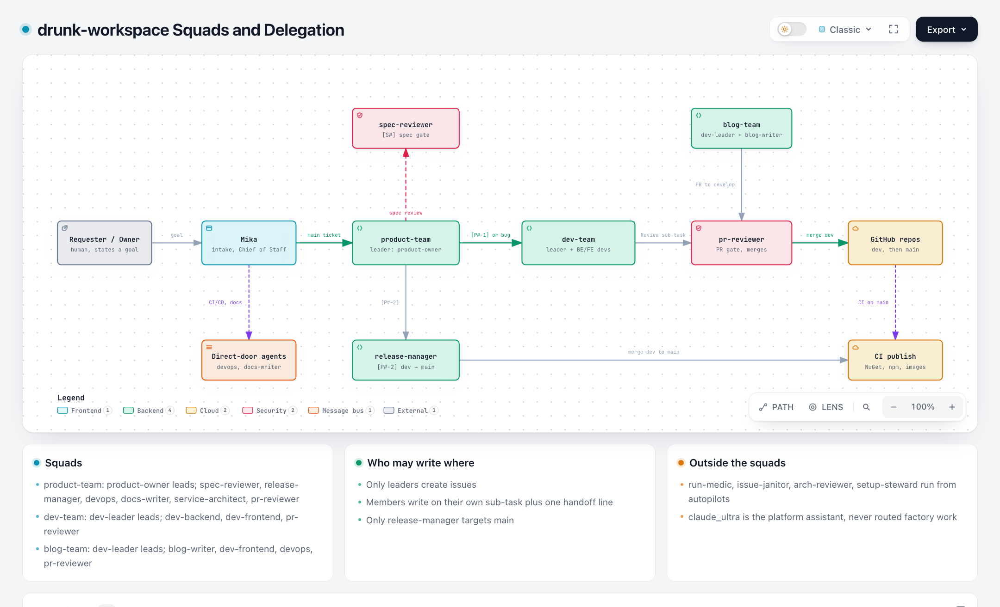
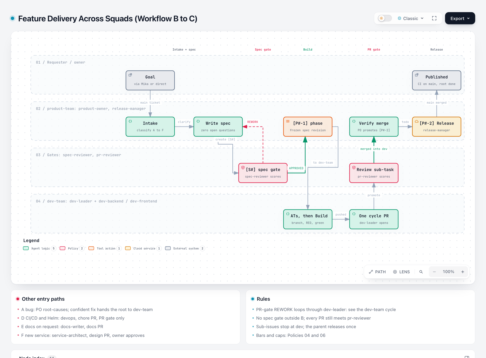
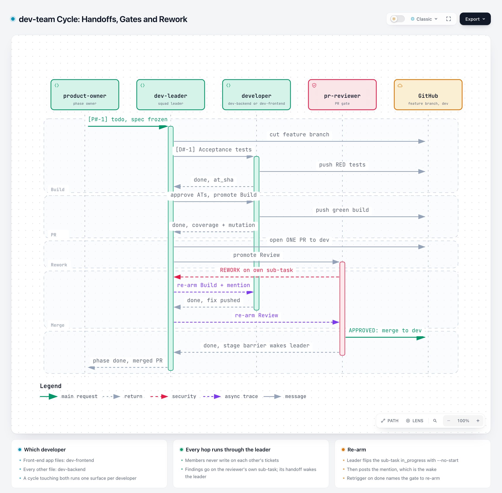
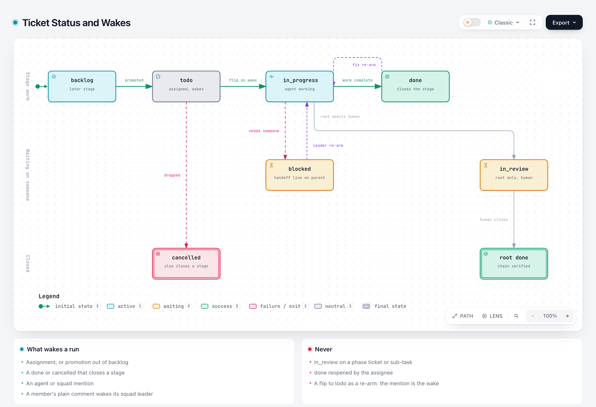

# drunk workspace: setup and how the squads work together

How the drunk workspace (`export/drunk-workspace/`) is put together, and how
its agents and squads hand work to each other from a human's goal to a
published package. This page describes the setup; it does not define it.
The rules live in `export/drunk-workspace/docs/policies/`, and every section
below links the policy that governs it. When this page and a policy disagree,
the policy is right and this page is stale.

Diagrams are rendered with [archify](https://github.com/tt-a1i/archify). Each
image links to its interactive HTML source in `.archify/` (open it in a
browser for dark mode, path tracing and export).

## 1. What the workspace is

- **What it builds.** The open-source `github.com/baoduy` repos: .NET/NuGet
  libraries, Pulumi/npm packages, Python MCP services, Docker images, Helm
  charts, and the drunkcoding.net blog. There is no deployed environment.
  Publishing the package or image from `main` IS the release.
- **Branches.** `dev` is integration, `main` is release. Only
  release-manager targets `main` (the blog repo uses `develop` and the owner
  deploys it). See Policy 03.
- **Policy first.** Policies are the source of truth. Skills implement them,
  agents and squads load the skills, and code is checked against them at the
  gates. A change starts with the policy and cascades down
  ([policy index](../export/drunk-workspace/docs/policies/00-policies-index.md)).

### What an agent receives on every run

| Layer | File | Who sees it |
|---|---|---|
| Workspace Context | `workspace/workspace.context.md` | Every agent, every run: statuses, wakes, ticket and git rules, report shapes |
| Agent instructions | `agents/<name>.md` | That agent: identity, triggers, hard limits, skills to load |
| Squad instructions | `squads/<name>.md` | The squad **leader** only, with a platform-generated roster |
| Skills | `skills/<name>/SKILL.md` + `references/` | Written into the run's working directory; cost tokens only when opened |
| Gate state | `Gate verdict`, `Gate round`, `Gate score` properties | Read and written on review sub-tasks |

Models and runtimes per agent: see the table in
[`export/drunk-workspace/README.md`](../export/drunk-workspace/README.md#agent--model-assignment).
Role charters (goal, responsibilities, "never" list): Policy 09.

## 2. Squads and delegation

Interactive diagram: `.archify/architecture-squads/squads.html`.

### Squads

From `export/drunk-workspace/squads/*.json`.

| Squad | Leader | Members | Delivers |
|---|---|---|---|
| **product-team** | product-owner | spec-reviewer, release-manager, devops, docs-writer, service-architect, pr-reviewer | A feature end to end: spec, gated review, delegated build, release. Read-only on code. |
| **dev-team** | dev-leader | dev-backend, dev-frontend, pr-reviewer | One approved spec or confirmed bug as exactly ONE merged PR into `dev`. Never releases. |
| **blog-team** | dev-leader | blog-writer, dev-frontend, devops, pr-reviewer | One reviewed PR into `develop` of `hbd.astro-paper`. The owner deploys `develop`→`main`. |

Some agents sit in more than one squad. pr-reviewer is in all three, dev-leader
leads two, and devops and dev-frontend each serve two. The squad a ticket is
assigned to decides which briefing the leader follows.

### Agents outside the squad flow

| Agent | Role | Entry |
|---|---|---|
| **Mika** | Chief of Staff: turns a human goal into a main ticket in the right project and routes it | Human conversation; also runs the live sync and stall sweep autopilots |
| **devops** | CI/CD, build/publish automation, Helm charts (Workflow D) | product-owner, or a requester assigns it directly |
| **docs-writer** | Library and API docs, only when a human asks (Workflow E) | product-owner, or a requester assigns it directly |
| **service-architect** | Design of a new service before its first code (Workflow F) | product-owner only |
| **arch-reviewer** | Monthly architecture sweep; files findings, opens test/config-only enforcement PRs | Autopilot |
| **run-medic** | Hourly recovery of runs killed by transient failures | Autopilot |
| **issue-janitor** | Weekly status propagation and cleanup of cancelled issues | Autopilot |
| **setup-steward** | Weekly retro of this setup; fixes land on `dev` of this repo | Autopilot (see [improvement loop](drunk-setup-improvement-loop.md)) |
| **claude_ultra** | Platform assistant; never routed factory work | Human |

### Ground rules for collaboration

These come from the Workspace Context and Policy 09:

- **Only leaders create issues.** product-owner in product-team, dev-leader in
  dev-team and blog-team. Members report on their own sub-task.
- **Members write only on their own ticket**, plus one handoff line on the
  parent. Anything meant for another member goes on the member's own ticket.
  The handoff line wakes the leader, and the leader routes it.
- **Members never create a branch or push one of their own** (Policy 03
  statement 3b). The leader cuts the feature branch and opens the one PR;
  members push their commits onto it by refspec. On a blog-team content
  ticket, blog-writer opens its own `blog/<slug>` PR instead
  (`squads/blog-team.md`). devops, docs-writer and service-architect are not
  squad members, so each cuts its own `chore/`, `docs/` or `design/<key>`
  branch.
- **Humans act through assignment.** A mention of a human only renders a
  link. To make a human act, reassign the ticket to them at `todo` with a
  `## BLOCKER` comment.
- **Ticket keys.** Roots carry a type prefix (`[Feature]`, `[Bug]`, `[CICD]`,
  …). Children are `[S<num>]` spec review, `[P<num>-n]` product phases and
  `[D<num>-n]` dev-team stages, where `<num>` is the parent's key number.

## 3. Feature delivery across squads (Workflow B → C)

Interactive diagram: `.archify/workflow-feature-delivery/feature-delivery.html`.

1. **Intake.** A human states a goal, through Mika or directly. product-owner
   classifies the ticket (Workflows A–F), moves it to the project that owns
   the repo, labels and prefixes it.
2. **Clarify and spec.** product-owner asks numbered questions until none
   are open, then writes the spec on the root ticket (`sdlc-spec-template`).
3. **Spec gate.** product-owner creates `[S<num>] Spec review` for
   spec-reviewer. REWORK comes back to product-owner, who revises and re-arms
   the gate. Bar and caps: Policies 04 and 06.
4. **Hand to dev-team.** On APPROVED, product-owner creates
   `[P<num>-1] Implementation` assigned to the dev-team squad, carrying the
   full spec at a frozen revision. On a root ticket whose change a package
   consumer can see, it also creates `[P<num>-2] Release` for
   release-manager at `backlog`.
5. **Build and PR gate.** dev-team runs its cycle (section 4) and pr-reviewer
   merges the one PR into `dev`.
6. **Release.** product-owner checks that the PR merged, then promotes
   `[P<num>-2]`. release-manager opens and merges ONE `dev`→`main` PR, CI
   publishes, and product-owner closes the root `done`.

A sub-issue stops after step 5. Its parent releases all children once.
Two or more changes to one repo become one bundle root with one sub-issue per
stage (Policy 05 statement 1c).

### Other workflows

From `skills/sdlc-flow-po-orchestration/SKILL.md`:

| Workflow | Work | Path |
|---|---|---|
| **A** | Question or bug | product-owner finds the root cause with a confidence score. A confident or confirmed bug hands the **root** to dev-team (no spec gate). dev-leader hands it back for the release when a package consumer can see the change. |
| **B → C** | Feature or enhancement to a library | As above |
| **D** | CI/CD, build automation, Helm charts | devops on a `chore/<key>` PR to `dev`, then `[P<num>-1c]` PR gate. No spec gate, no release-manager. |
| **E** | Docs a human asked for | docs-writer on a `docs/<key>` PR, then the PR gate |
| **F** | A new service | service-architect on a `design/<key>` PR adding `docs/architect/`; merges only on the owner's reply |
| Blog | Post, site code or CI for drunkcoding.net | Assigned to the blog-team squad; product-owner never handles it |

## 4. Inside a dev-team cycle

Interactive diagram: `.archify/sequence-dev-team-cycle/dev-team-cycle.html`.

- **Route decision first** (`squads/dev-team.md`). Route A is code with
  tests. Route B is configuration only. Route A also has variants: bug fix,
  UI presentation, coverage-excluded wiring and owner test waiver. Each
  variant changes which stages exist (Policy 02 statement 1).
- **One developer per surface** (Policy 02 statement 1g). Files inside a
  front-end app (`ui/` in DKNet.Accounts.Api, the Astro site code) go to
  dev-frontend; every other file goes to dev-backend. A cycle touching both
  splits into one surface per developer.
- **Acceptance tests before code.** The surface's developer writes the
  spec's scenarios as failing tests and pushes them. dev-leader reads them
  against the spec and freezes them as `at_sha`. The same developer then
  builds against the frozen tests. Independent surfaces may build in
  parallel (Policy 02 statement 1c).
- **One branch, one PR.** dev-leader cuts the feature branch before stage 1
  and opens the single PR after the last Build.
- **Rework goes through the leader.** pr-reviewer posts findings on its own
  Review sub-task. dev-leader re-arms the Build, and when that is done,
  re-arms the Review. Members never write on each other's tickets.
- **Docs impact is a report line**, never a stage. A dev-team cycle writes no
  docs pages (Policy 05 statement 3a).

blog-team follows the same leader playbook with its own routes
(`squads/blog-team.md`). For content, blog-writer opens the PR itself, and
everything targets `develop`.

## 5. Ticket status and wakes

Interactive diagram: `.archify/lifecycle-ticket-status/ticket-status.html`.

Squads coordinate through ticket status rather than chat. The rules are in the
Workspace Context, **Status and wakes**:

- **A child ticket ends every turn `done` or `blocked`.** `in_review` is only
  for a root whose deliverable waits on a human.
- **Stages.** Sub-issues are created with `--stage <n>`: the active stage at
  `todo`, later ones at `backlog`. When every sub-issue at a stage is closed,
  the platform wakes the parent's assignee (the squad leader). That is the
  stage barrier.
- **What enqueues a run:** assignment or promotion into `todo`, a stage
  barrier, an agent or squad mention, or a member's plain comment on a
  squad-assigned ticket (wakes the leader).
- **Re-arm.** `done` is one-way for the assignee. The leader flips the ticket
  to `in_progress` with `--no-start`, then posts the mention that wakes it.
  `Retrigger on done` records which blocked gate to re-arm afterwards.

## 6. Standing maintenance

From `export/drunk-workspace/autopilots/*.json`:

| Autopilot | Schedule | Agent | Status |
|---|---|---|---|
| 🔁 Hourly Run Recovery | hourly at :05 UTC | run-medic | active |
| 🌤️ Daily Stall Sweep | daily 09:00 SGT | Mika | paused |
| 🧽 Weekly Issues Hygiene Cleanup | Sun–Mon 09:00 SGT | issue-janitor | active |
| 🔁 Weekly Multica Setup Retro | Mon 09:00 SGT | setup-steward | active |
| 🔄 Drunk Live Sync | webhook (merge to `main`) | Mika | active |
| 🚀 Monthly Architecture Review — DKNet + DKNet.Templates | 1st of month | arch-reviewer | active |
| 🚀 Monthly Architecture Review — Pulumi repos | 4th of month | arch-reviewer | paused |
| 🚀 Monthly NuGet Upgrade — DKNet | 15th of month | dev-leader | paused |
| 🚀 Monthly npm Upgrade — Pulumi repos | 16th of month | dev-leader | paused |
| 📊 Monthly Insights & Multica Release Review | 1st of month | `default` | active |

How this setup improves itself and reaches the live workspace:
[drunk setup improvement loop](drunk-setup-improvement-loop.md).

## 7. Where to change things

| You want to change… | Edit first | Then cascade to |
|---|---|---|
| A rule of the flow, a gate bar, a stage | The policy (`docs/policies/0X-*.md`) and `CHANGELOG.md` | The skills in its "Related skills" row, then agent and squad instructions |
| Who does what in a squad | Policy 09 charter | `squads/<name>.md`, `agents/<name>.md` |
| Platform-wide constants (statuses, wakes, git rules) | `workspace/workspace.context.md` | Nothing; skills cite it |
| A diagram on this page | `.archify/<diagram>/candidate.json` | Rerun archify `finalize`, refresh the PNG in `output/squads-presentation/` |

Repository rules for these edits (commit to `dev`, `drunk:` prefix, ask
before pushing live): [`CLAUDE.md`](../CLAUDE.md).
